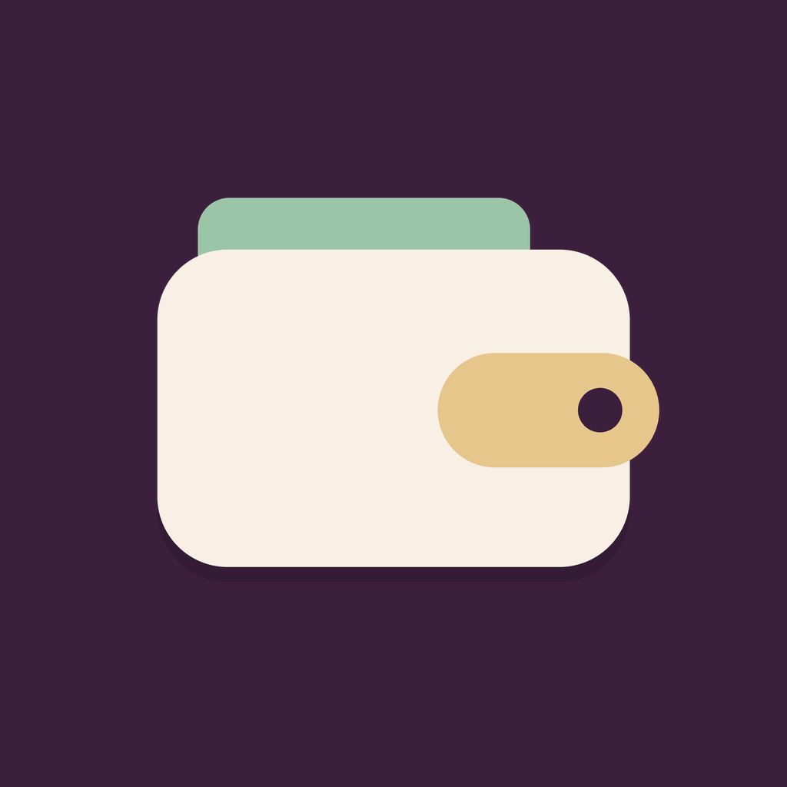
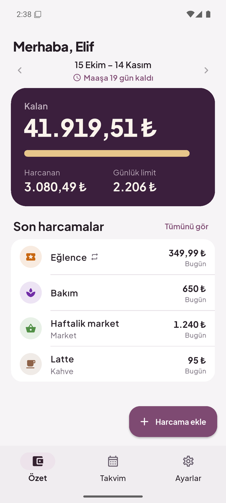
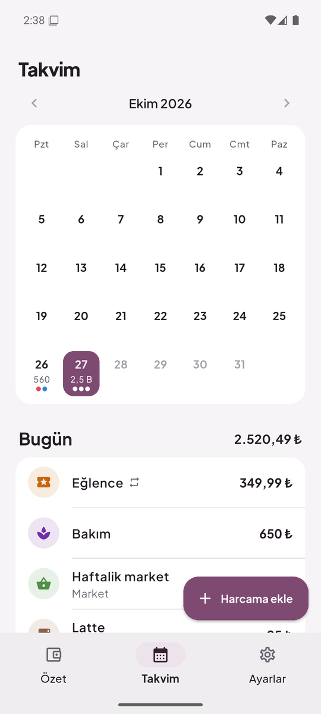
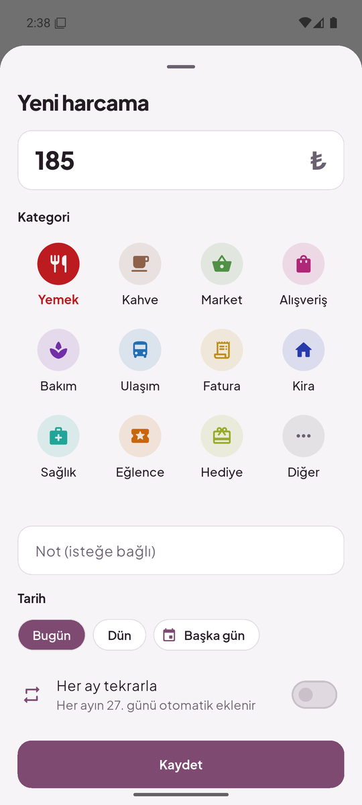
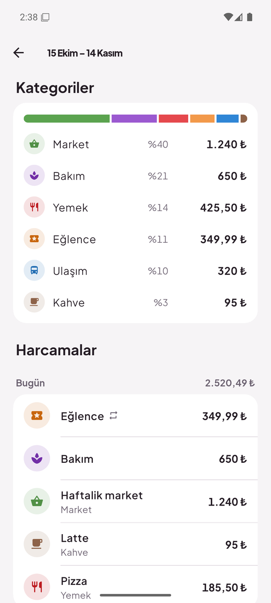
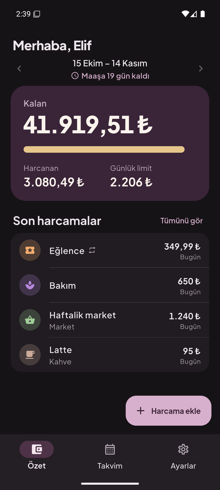

<p align="center">
  
</p>

<h1 align="center">Cüzdan</h1>

<p align="center">
  A simple salary and expense tracker for Android.<br>
  Enter your salary once, log what you spend, and always know what is left until payday.
</p>

<p align="center">
  
  
  
</p>

## Features

- **Remaining balance at a glance.** The summary shows what is left of this period's salary, how much has been spent, and a daily limit that keeps you on budget until payday.
- **Custom payday.** Periods run from payday to payday (for example the 15th to the 14th), not just calendar months. Short months are handled automatically.
- **Fast expense entry.** Type the amount, tap a category, done. Shortcuts for today and yesterday, and an optional note.
- **Colored categories.** Twelve categories, each with its own color and icon, plus a breakdown of where the money went.
- **Calendar view.** See daily totals and category dots for every day of the month, and tap a day to see its expenses.
- **Recurring expenses.** Rent, bills and subscriptions are added automatically on the same day every month, including months the app was not opened.
- **Undo.** Swipe an expense away to delete it, and undo if it was a mistake.
- **Excel export.** Save every expense and a per-period summary as an `.xlsx` file.
- **Light and dark themes**, following the system or set manually.
- **Private by design.** No account and no server; all data stays on the device in a local SQLite database.

<p align="center">
  
  
</p>

## Tech stack

| Area | Choice |
| --- | --- |
| Framework | [Flutter](https://flutter.dev) (Android first, iOS ready) |
| State management | [Riverpod 3](https://riverpod.dev) |
| Storage | [sqflite](https://pub.dev/packages/sqflite) |
| Excel export | [excel](https://pub.dev/packages/excel) and [file_picker](https://pub.dev/packages/file_picker) |
| Localization | `flutter_localizations` with ARB files |
| Font | [Plus Jakarta Sans](https://github.com/tokotype/PlusJakartaSans) (SIL Open Font License) |

The user interface is in Turkish. All code, comments and identifiers are in English, and every user-facing string lives in [`lib/l10n/app_tr.arb`](lib/l10n/app_tr.arb), so adding another language only needs a new ARB file.

## Getting started

Requirements: Flutter 3.47 or newer and the Android SDK.

```bash
git clone https://github.com/factaxd/pocket-budget.git
cd pocket-budget
flutter pub get
flutter run
```

Run the tests:

```bash
flutter test
```

Build an APK for a phone (most current phones use `arm64-v8a`):

```bash
flutter build apk --release --split-per-abi
# build/app/outputs/flutter-apk/app-arm64-v8a-release.apk
```

The release build is signed with the debug key, which is fine for installing on your own devices. Publishing to Google Play needs a proper signing key.

## Project structure

```text
lib/
├── core/            # Dates, money formatting, theme and colors
├── data/            # SQLite database and repositories
├── domain/          # Expenses, categories, pay periods, recurring expenses
├── features/
│   ├── calendar/    # Month view with daily totals
│   ├── expense/     # Add and edit expense sheet
│   ├── export/      # Excel export
│   ├── home/        # Summary tab and full period list
│   ├── onboarding/  # First run: name, salary and payday
│   ├── recurring/   # Recurring expenses
│   ├── settings/    # Settings tab
│   ├── shared/      # Widgets used across features
│   └── shell/       # Bottom navigation
├── l10n/            # Turkish strings
├── app.dart
├── main.dart
└── providers.dart   # Riverpod providers and actions
```

Amounts are stored as whole kuruş (1/100 lira) to avoid rounding errors.
